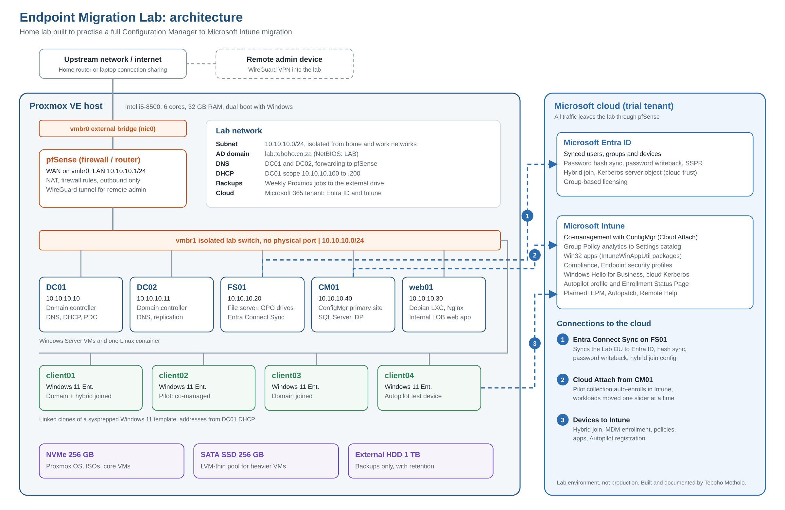

# Endpoint Migration Lab

A home lab where I built a small company's Windows estate from scratch (Active Directory, Group Policy, Configuration Manager) and am migrating it to Microsoft Entra ID and Microsoft Intune, the way an enterprise would.

> **This is a lab, not a production environment.** It runs on one PC and a Microsoft 365 trial tenant. Everything here was built, broken and fixed by me, and the problems I hit are documented in [lessons learned](docs/lessons-learned.md).



## What's in it

| Layer | Built with |
|---|---|
| Virtualisation | Proxmox VE, two bridges (one isolated), LVM-thin, scheduled backups |
| Network | pfSense firewall and NAT, isolated `10.10.10.0/24`, WireGuard |
| Identity | Active Directory with two DCs, DNS, DHCP, Entra Connect Sync, hybrid join |
| On-prem management | Group Policy, file services, Configuration Manager with SQL Server |
| Cloud management | Intune co-management, Group Policy analytics, Settings catalog, Win32 apps, Autopilot, compliance, Windows Hello cloud trust |
| Intune Suite | Endpoint Privilege Management, Windows Autopatch, Remote Help |
| Other | Debian container running Nginx as an internal line-of-business web app |

## Progress

Status is taken from the [evidence pack](evidence/Lab_Evidence_Pack.pdf), collected on 20 November 2026.

| Phase | Docs | Status |
|---|---|---|
| Infrastructure: Proxmox, pfSense, network | [01](docs/01-proxmox-and-network.md), [02](docs/02-pfsense.md) | Done; backup storage needs pruning |
| Active Directory, DC02, file services, GPO | [03](docs/03-active-directory.md), [04](docs/04-file-services-and-gpo.md) | Done; DC02 time drift being fixed |
| Configuration Manager site | [05](docs/05-configmgr.md) | Done |
| Entra Connect, hybrid join, co-management | [06](docs/06-hybrid-identity.md) | Done |
| GPO to Intune | [07](docs/07-gpo-migration.md) | Done for the pilot |
| Apps to Intune Win32 | [08](docs/08-app-migration.md) | Done (7-Zip); VLC fix awaiting retry |
| Autopilot | [09](docs/09-autopilot.md) | In progress, no device registered yet |
| Cloud Kerberos Trust, SSPR, LOB app sign-in | [10](docs/10-cloud-kerberos-and-sspr.md) | In progress, Windows Hello not provisioned |
| Backups | [11](docs/11-backups.md) | Done |
| Intune Suite: EPM, Autopatch, Remote Help | | Done |
| Conditional Access, BitLocker, LAPS, ASR | | Next |
| Azure Virtual Desktop and Windows 365 | | Planned |
| Retire ConfigMgr | | Planned |

## Evidence

- [Lab_Evidence_Pack.pdf](evidence/Lab_Evidence_Pack.pdf): every phase with checks, script output and screenshots, plus open items
- [evidence/](evidence/): raw output from the read-only collection scripts (DC01, FS01, CM01, client02, Proxmox), GUIDs and SIDs redacted
- [images/screenshots/](images/screenshots/): 34 Intune and Entra portal screenshots
- [scripts/evidence/](scripts/evidence/): the scripts that produced it, so anyone can rerun them

Start with [00-architecture.md](docs/00-architecture.md) for the full design and IP plan.

## Problems solved

Eleven real issues, each with symptom, diagnosis, root cause and fix: [docs/lessons-learned.md](docs/lessons-learned.md). A few:

- Entra Connect failing with `AADSTS700027` because every server was in the wrong time zone, so UTC was 9 hours ahead
- ConfigMgr SQL prerequisite failures caused by TCP/IP being off, not by the settings the check named
- Windows Hello cloud trust not applying because co-management workloads were still owned by ConfigMgr
- Sysprep blocked by BitLocker auto-enabled through the virtual TPM
- A Win32 app failing on every device because of one wrong install command
- DC02 replication failing with error 1398, found by the evidence scripts

## Repo layout

```
docs/       one file per phase, plus lessons-learned.md
scripts/    PowerShell and bash used during the build (see scripts/README.md)
configs/    sanitised config files with placeholders
images/     architecture diagram and portal screenshots
evidence/   evidence pack PDF and raw script output
case-study.pdf
```

## Skills shown

Proxmox VE, pfSense, Windows Server, Active Directory, DNS, DHCP, Group Policy, file services, Configuration Manager, SQL Server, Microsoft Entra ID, Entra Connect Sync, Microsoft Intune, co-management, Windows Autopilot, Windows Hello for Business, Endpoint Privilege Management, Windows Autopatch, Remote Help, PowerShell, Microsoft Graph, Linux, Nginx, troubleshooting from logs.

## Links

- Case study: [case-study.pdf](case-study.pdf)
- Demo videos: _coming soon_
- Portfolio: _https://tebohomotholo.netlify.app/_

## Notes

No passwords, keys, tenant IDs or public IPs are stored in this repo. Example values use placeholders like `<TENANT_ID>`. Lab IPs and the lab domain name are shown because they only exist inside the lab.

Author: Teboho Motholo
