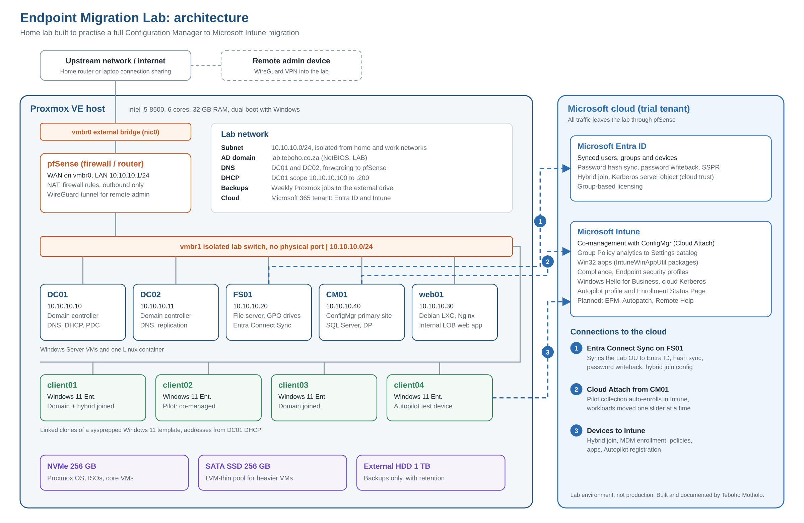

# 00. Architecture

## Purpose

A small company built from scratch on one PC, used to practise a full migration from on-premises management (Active Directory, Group Policy, Configuration Manager) to cloud management (Microsoft Entra ID and Microsoft Intune).

This is a lab. It is built to practise real enterprise tasks, not to run production workloads.

## Hardware

| Component | Detail |
|---|---|
| CPU | Intel Core i5-8500, 6 cores, 6 threads |
| RAM | 32 GB |
| Disk 1 | 256 GB NVMe: Proxmox OS, ISOs, core VMs |
| Disk 2 | 256 GB SATA SSD: LVM-thin pool for heavier VMs |
| Disk 3 | 256 GB SATA SSD: existing Windows install (dual boot, untouched) |
| Backup | 1 TB external drive, backups only |

## Network design

| Network | Range | Purpose |
|---|---|---|
| Upstream | Home router, or laptop connection sharing (`192.168.137.0/24`) | Internet access for Proxmox and pfSense WAN |
| Lab LAN | `10.10.10.0/24` | Everything else, behind pfSense |
| WireGuard tunnel | `10.20.20.0/24` | Remote admin access into the lab |

Proxmox has two Linux bridges:

- `vmbr0` is bridged to the physical NIC. Only the Proxmox host and pfSense WAN use it.
- `vmbr1` has **no physical port**. Every lab VM connects here, so lab DHCP and AD can never leak onto the real network.

## Systems

| Name | Address | Role | Platform |
|---|---|---|---|
| pfsense | 10.10.10.1 | Firewall, router, NAT, WireGuard | pfSense CE |
| DC01 | 10.10.10.10 | Domain controller, DNS, DHCP, PDC emulator | Windows Server |
| DC02 | 10.10.10.11 | Domain controller, DNS | Windows Server |
| FS01 | 10.10.10.20 | File server, Entra Connect Sync | Windows Server |
| web01 | 10.10.10.30 | Internal web app (stand-in for a line-of-business app) | Debian LXC, Nginx |
| CM01 | 10.10.10.40 | Configuration Manager primary site, SQL Server | Windows Server |
| client01 to 04 | DHCP .100 to .200 | Workstations | Windows 11 Enterprise |

## Identity

| Item | Value |
|---|---|
| AD domain | `lab.teboho.co.za` |
| NetBIOS | `LAB` |
| OU root | `OU=Lab` with `Users`, `Groups`, `Computers`, `Servers`, `IT`, `Service Accounts` |
| Cloud tenant | Microsoft 365 trial tenant (Entra ID P1, Intune) |
| Sync scope | `OU=Lab` and children, except `Service Accounts` |

## Build phases

| Phase | Doc | Content |
|---|---|---|
| 0 | [01](01-proxmox-and-network.md), [02](02-pfsense.md), [03](03-active-directory.md), [04](04-file-services-and-gpo.md) | Infrastructure and the starting estate |
| 1 | [05](05-configmgr.md) | Configuration Manager site |
| 2 | [06](06-hybrid-identity.md) | Entra Connect, hybrid join, co-management |
| 3 | [07](07-gpo-migration.md), [08](08-app-migration.md), [09](09-autopilot.md), [10](10-cloud-kerberos-and-sspr.md) | The migration |
| Ops | [11](11-backups.md) | Backups |
